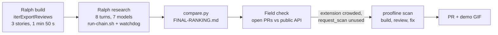

# How I worked on my Proofline application

My application PR is **[`proofline scan`](PR_LINK)** for the Proofline CLI. This repository shows the work around it: how I split tasks for coding agents, ran them through [Ralph TUI](https://github.com/subsy/ralph-tui), checked what they produced, and where I changed course.

Everything here happened on 17 November 2026. Times come from the logs in this repository.

## Summary

| When | Step | Result |
|---|---|---|
| 08:51 to 08:53 | **Build with Ralph.** A TypeScript SDK feature (`iterExportReviews`) split into 3 stories and run with Claude Sonnet. | All 3 stories passed, one iteration each, in 1 min 50 s. 66 of 66 tests pass. Not submitted: 7 open PRs already add export paging. |
| 09:15 to 14:07 | **Research with Ralph.** One research brief run by 7 models, one after another, each in its own folder. | Merged into one pain ranking. The top feature was "Copy for coding agent" in the Chrome extension. |
| after 14:07 | **Check against the field.** A separate, agent-run review of the open PRs and the public API, checked by a second agent. | The extension was crowded (21 open applicant PRs, 4 of them on redaction). The CLI's contract had `request_scan`, which no command used and no applicant PR touched. |
| by 18:08 | **Build and review `proofline scan`.** Built with an agent, then a review pass for failure paths found 6 issues, all fixed. | 9 new integration tests; fmt, clippy and every test target pass. Details in the PR. |

The research did not pick `proofline scan`. It mapped what hurts people who hand bugs to coding agents, and its pick was an extension feature. I switched because of what the field check found. The research still shaped the design: it showed that the useful work is turning evidence into something an agent or a CI job can act on.

## 1. Building with Ralph ([`ralph-build/`](ralph-build/))

[`prd-iter-export-reviews.md`](ralph-build/prd-iter-export-reviews.md) is the spec. [`prd-iter-export-reviews.json`](ralph-build/prd-iter-export-reviews.json) is the same spec as 3 Ralph stories: implement, test, document. The guardrails name the only files that may change, forbid touching generated code or adding dependencies, forbid commits, and require build, lint, typecheck and tests before a story counts as passed.

| Story | Time | Outcome (from the agent's own notes in [`progress.md`](ralph-build/progress.md)) |
|---|---|---|
| US-001 implement | 23 s | `iterExportReviews` added to `src/index.ts`; 60 of 60 existing tests pass |
| US-002 test | 64 s | 6 new tests (66 of 66). Mutation check: removing the repeated-cursor guard makes one test fail. |
| US-003 document | 21 s | README "Review exports" section rewritten; nothing else changed |

Ralph's summary is in [`run-summary.txt`](ralph-build/run-summary.txt), and the PR text I prepared is in [`PR-description.md`](ralph-build/PR-description.md). I reran lint, typecheck and the tests after the run (66 of 66). I did not submit it, because the same feature was already open in 7 applicant PRs: 2 in the TypeScript SDK, 4 in the Python SDK and 1 in the CLI. That is what sent me looking for an uncrowded need.

## 2. Research with Ralph ([`research/`](research/))

### How it is set up

| File | Role |
|---|---|
| [`prd-pain-research.md`](research/prd-pain-research.md) | The brief: goal, guardrails, search toolkit, output formats, scoring rubric |
| [`00-context-notes.md`](research/00-context-notes.md) | Background every run read: the repos and the open PRs not to duplicate |
| `runs/<n>/prd.json` | The brief as 5 stories: plan, collect evidence, re-verify sources, score and rank, recommend |
| [`run-turn.sh`](research/run-turn.sh) | Runs one turn: rewrites the shared Ralph config for that turn's agent and model, then runs Ralph headless with `--verify` |
| [`run-chain.sh`](research/run-chain.sh) | Runs turns strictly in sequence; logs any change to the extension repo, which runs may only read; pauses if a turn passes no story |
| [`watch.sh`](research/watch.sh) | Health check run every 5 minutes while the chain ran: is Ralph alive, story progress, newest file, warnings. The `WATCHDOG` lines in the log are the fixes made from those checks. |
| [`runs/queue.log`](research/runs/queue.log) | The real chain log, failures included |
| [`compare.py`](research/compare.py) → [`compare/comparison.md`](research/compare/comparison.md) | Compares run health and top picks across runs |
| [`FINAL-RANKING.md`](research/FINAL-RANKING.md) | Merged pain ranking and feature ranking, with caveats |
| [`agent-plugin/`](agent-plugin/) | A Ralph agent plugin for the Command Code CLI, and a variant made during the run |

Each run had to stay in its own folder and never read another run's folder. No git writes, no sign-ins, nothing posted anywhere. Each claim had to cite a URL the agent had opened, with quotes of 30 words or fewer and unopened pages marked unverified.

### The runs

| Turn | Agent / model | Stories | Minutes | Sources the run reports re-opening |
|---|---|---|---|---|
| 1 | Command Code / DeepSeek v4 Flash | 5/5 | 22 | 67 |
| 2 | Command Code / MiniMax m3.1 Flash | 5/5 | 65 | 60 |
| 3 | Command Code / GPT-6 Luna | 5/5 (second attempt) | 15 | 14 |
| 4 | Claude Code / Sonnet | 5/5 | 18 | 51 |
| 5 | Command Code / DeepSeek v4 Pro | 5/5 | 18 | 25 |
| 6 | Command Code / MiniMax m3 | 5/5 | 43 | 51 |
| 7 | Command Code / GPT-6 Astra | 0/5, skipped | 0 | model not included in my plan |
| 8 | Claude Code / Opus | 5/5 | 25 | 78 |

The source counts are each run's own report of what it re-opened. I checked the evidence behind the top pains by hand; for example, claude-code [#57034](https://github.com/anthropics/claude-code/issues/57034) has 76 reactions and [#12676](https://github.com/anthropics/claude-code/issues/12676) has 57.

### What went wrong, and what I did

All of these are in [`queue.log`](research/runs/queue.log).

- **GPT-6 Luna could not write files.** Its first attempt passed 0 of 5 stories after 7 iterations; the agent said it was in read-only plan mode. The cause was the `--tools-all` flag. I added a plugin variant without it ([`command-code-research-std.js`](agent-plugin/command-code-research-std.js)); web search and fetch still worked. I reset turns 3 and 4 and reran them.
- **The chain did not stop for that failure.** It went straight on to turn 4, which I reset by hand. The zero-pass stop in `run-chain.sh` was not in effect yet. It did pause the chain at turn 7.
- **MiniMax m3 entered plan mode** on its first iteration and stopped after 8 seconds. I added a "do not use plan mode" note to its unpassed stories, and the next iteration worked.
- **GPT-6 Astra** passed nothing because my plan does not include that model. The chain paused itself; I skipped the turn and ran Opus.
- **The logged exit codes are wrong.** While writing this up I found that every `CHAIN turn N exit=` line in the log reads 0, even after turn 7's `exit=1`. In `run-chain.sh`, `$?` sat in the same string as `$(date)`, which reset it. The copy here is fixed and the comment says so. The `END` lines, written by `run-turn.sh`, were always correct.
- **Turn 1 ran on an earlier script.** It was started by [`run-all.sh.retired`](research/run-all.sh.retired), which ran four fixed runs from per-run configs. I replaced it with `run-turn.sh` and `run-chain.sh` (one shared config, rewritten per turn), which ran turns 2 to 8.

### Limits of this research

- **Anchoring.** Every run read the same context notes, which already named "Copy for coding agent" as my leaning. So agreement on the top feature is partly inherited. By name it was the top pick in 5 of 7 runs; 6 if GPT-6 Luna's "one-click agent hand-off" counts. The pain ranking is more independent, because it comes from evidence the runs found.
- **Uneven evidence.** Reddit was mostly blocked or thin. GitHub issues, the Cursor forum and Hacker News carried most of the evidence. GPT-6 Luna cited only 14 sources and should be weighted lower.
- **Not included:** raw scraped pages (`raw/`, about 30 MB, left out for size and copyright) and Ralph's full logs. Every cited URL is in each run's `sources.md`.

## 3. Design notes ([`designs/`](designs/))

These are drafts of the two extension features the research ranked highest. I wrote them before switching to the CLI, and neither was built.

## 4. The submitted PR: `proofline scan`

It came from comparing the operations in the CLI's `openapi.public.json` with the operations its commands use (an agent-run gap check that a second agent re-verified). `request_scan`, the only scan operation, was declared but unused, and the only PR touching it was the maintainer's contract sync. A scan spends credits, so the design is about never spending a budget the caller did not choose and never paying twice:

- `--budget` is required.
- The request is sent once.
- When the outcome is unknown, the command exits 4 and prints a `--request-id` that retries safely.
- Every server outcome is handled explicitly.

The PR description covers the decisions and the tests. The prompts I used are in a hidden comment in the PR body, as the repository's `AGENTS.md` asks.

### Demo ([`demo/`](demo/))

The recording runs the real CLI binary against [`mock_console.py`](demo/mock_console.py), a local stand-in for the three endpoints `proofline scan` uses. It is not Proofline's API, and the review content is made up. [`scan-demo.tape`](demo/scan-demo.tape) is the [VHS](https://github.com/charmbracelet/vhs) script that recorded it; `PROOFLINE_BIN=/path/to/proofline vhs scan-demo.tape` re-renders it.

## Notes

- `<mission>` in these files stands for my local working folder, and `<HOME>` for my home directory.
- Model and agent names are as I used them on 17 November 2026.
